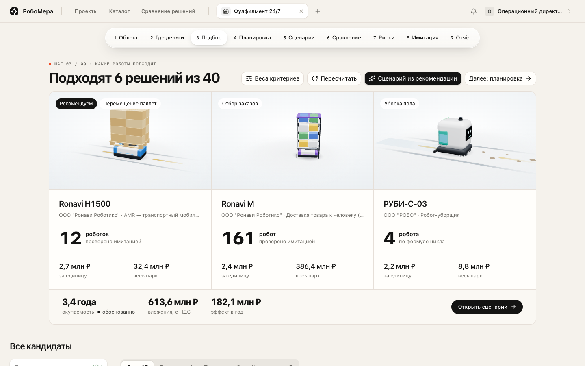
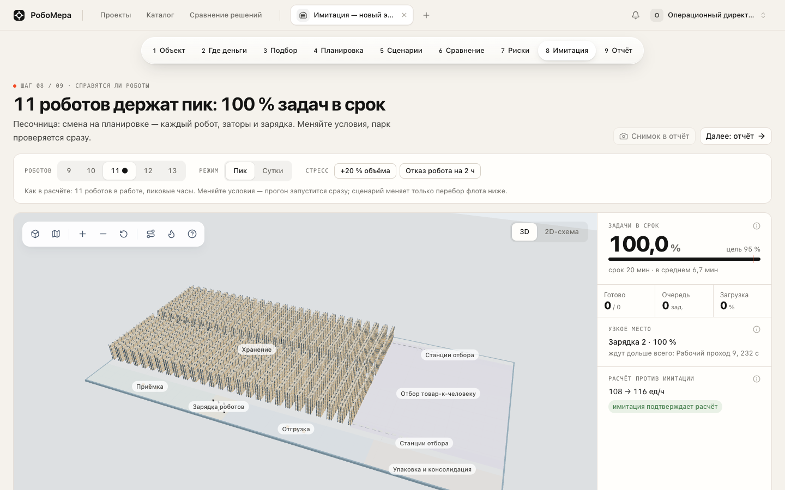
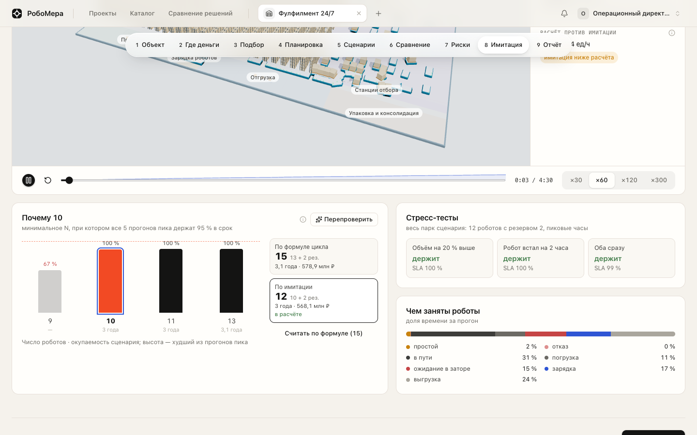
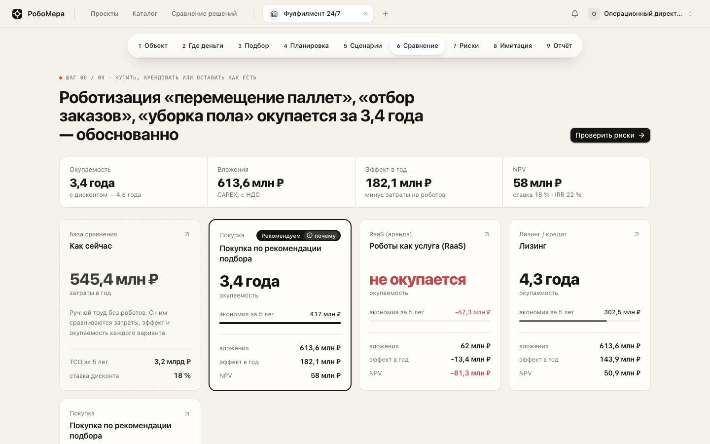
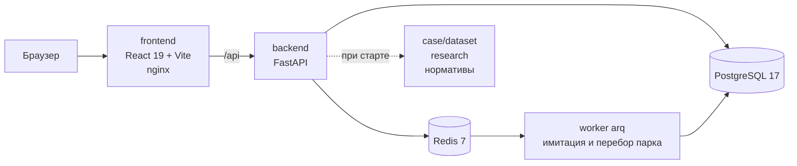

<div align="center">

# РобоМера

### Стоит ли роботизировать ваш объект

**Каталог роботов → объяснимый подбор → сколько нужно → сколько стоит → имитация на плане объекта → отчёт**

[](https://prooood.ru/)
[](https://prooood.ru/api/docs)


Задача 1 ЛЦТ 2026 от ДПиИР Москвы и АНО ФЦ БАС<br>
Платформа подбора роботизированных решений с расчётом экономического эффекта и визуализацией работы роботов на объекте

**[prooood.ru](https://prooood.ru/)** · [Попробовать без регистрации](https://prooood.ru/demo) · [Как запустить](#как-запустить) · [Методика](docs/METHOD.md) · [API](docs/api)

</div>

<p align="center">
  
</p>

> [!IMPORTANT]
> Формула даёт стартовое число роботов. Имитация ищет кандидаты по процессам, затем проверяет весь моделируемый парк вместе: каждый процесс должен выдержать сроки во всех повторах с общими ресурсами. Только актуальная совместная проверка подтверждает N для экономики. Пользователь видит формулу, кандидатов и результат общей проверки.

## Зачем это нужно

Директор склада, больницы или аэропорта хочет понять стоит ли вообще связываться с роботами. Обычно на это уходят недели переписки с интеграторами. В РобоМере он заводит объект и за несколько минут получает ответ крупно, а доказательство рядом.

| Вопрос | Что отвечает РобоМера |
|---|---|
| Какие роботы подходят именно мне | Подбор по каждому процессу объекта с причинами почему подходит или нет, в цифрах |
| Сколько их нужно | Расчёт по циклу с резервом и проверка имитацией на плане объекта |
| Сколько стоит и когда окупится | CAPEX, OPEX, эффект, окупаемость, NPV, IRR, TCO. Покупка, RaaS и лизинг рядом |
| Можно ли верить | Каждое число раскрывается до исходных значений и источника, допущения помечены |
| А если объём вырастет или робот сломается | Стресс-тесты в имитации, чувствительность и Монте-Карло |
| Что показать руководству | PDF и Excel отчёт со снимками имитации, допущениями и списком что уточнить |

## Как запустить

[Публичное демо](https://prooood.ru/demo) открыто без аккаунта. Можно открыть независимую копию склада,
фулфилмента, больницы или аэропорта либо создать свой объект, загрузить Excel/CSV/JSON или ввести параметры
вручную. Готовые примеры открываются с четырьмя рассчитанными сценариями и проверкой парка имитацией.
Короткий маршрут: объект → роботы → экономика → имитация → решение. Кнопка «Все инструменты» раскрывает
полный путь в той же копии, сохраняя все правки. Повторное открытие примера продолжает работу с копией.
Гость работает на тех же страницах и API, что и пользователь: подбор, планировка, экономика, сценарии,
сравнение, риски, 2D/3D-имитация и отчёты выполняют реальные расчёты с его текущими данными.

Гостевая сессия живёт **24 часа с момента создания**; обновление токенов не продлевает этот срок. Запросы после
истечения срока отклоняются сразу, очистка проектов, импортов, расчётов, журналов симуляции, отчётов и файлов
выполняется в API каждую минуту и после старта. «Сбросить демо» удаляет пространство немедленно. Копии гостей
изолированы обычными проверками владельца, исходные наборы остаются неизменными.

«Сохранить надолго» предлагает регистрацию или вход и переносит **все** гостевые проекты вместе с результатами
и файлами в аккаунт. Перед переносом нужно дождаться завершения фоновых задач. Организации, приглашения,
запросы производителям и ключи API требуют аккаунта; повседневная оценка объекта регистрации не требует.

Защита публичного доступа: файл до 5 МБ; Excel после распаковки до 25 МБ, до 100 000 ячеек; CSV/JSON до 10 000
строк/полей. Запрос ограничивается до разбора тела, включая загрузки без Content-Length: 6 МБ для гостя с учётом
multipart, 25 МБ для остальных. До 10 проектов, 30 сценариев, 100 фоновых задач, 100 МБ файлов, двух активных
задач и 12 запусков расчётов в минуту на сессию; до 10 новых сессий в час на IP. Имитация ограничена 24 часами,
500 роботами и оценкой 500 000 операций; Монте-Карло - 1000 прогонами. Все ограничения видны в `/demo`.
Гостевой API использует стандартные access/refresh JWT; web-refresh хранится в httpOnly-cookie, обновление и
перенос проектов защищены CSRF. Идентификатор проекта сам по себе не даёт доступа.

В Fly API приватный: nginx перезаписывает `X-Robomera-Client-IP` значением `Fly-Client-IP` публичного края,
`RS_CLIENT_IP_HEADER` разрешает доверять ему только в этой конфигурации. При прямом доступе к API оставляйте
настройку пустой: переданные клиентом IP-заголовки игнорируются.

Для обновления существующей БД выполните `alembic upgrade head` (миграция `0017_guest_sessions`); обычный
Docker/Fly запуск применяет миграцию сам. Старый публичный `/api/v1/demo/*` оставлен для обратной совместимости
и витрины лендинга; гостевое рабочее пространство использует стандартные проектные API.

Нужен только Docker с Docker Compose. Больше ничего ставить не надо, всё собирается в контейнерах. Проверяли на чистом клоне с пустой базой.

Под образы и сборку нужно около 4 ГБ свободного места на диске Docker. Если сборка падает с `no space left on device`, освободите место командой `docker builder prune` или увеличьте диск в настройках Docker Desktop.

```bash
git clone https://github.com/luhgeek1/robosim-studio-hack.git
cd robosim-studio-hack
docker compose up -d --build
```

Первая сборка идёт несколько минут. Потом открываются

| Что | Где |
|---|---|
| Интерфейс | http://localhost:3000 |
| Документация API (Swagger) | http://localhost:8000/api/docs |

База, миграции, справочники, каталог организатора и демо-учётки создаются сами при первом старте, руками ничего делать не нужно.

Остановить можно командой `docker compose down`, стереть все данные и начать с нуля `docker compose down -v`. Если порты 3000, 8000, 5432 или 6379 заняты, поменяйте левую часть в ports в docker-compose.yml.

Задеплоенная версия всегда открыта на **[prooood.ru](https://prooood.ru/)**, там всё то же самое.

## Автодеплой на Fly.io

Push в `main` запускает `.github/workflows/deploy.yml`: сразу выкладываются `robomera-api` (API и воркер arq),
затем `robomera` (фронтенд). Предварительные backend/контракт и frontend проверки временно отключены:
задания `check` и `frontend-check` имеют `if: ${{ false }}`, у `deploy` нет зависимости `needs`.
Чтобы вернуть проверки, удалите эти два условия и восстановите `needs: [check, frontend-check]` у `deploy`.
Локальные `make check` и `npm run check` доступны как прежде.
Перед обновлением API выполняется `alembic upgrade head`; ошибка миграции останавливает
выкладку. Сборка обоих образов идёт из корня репозитория на удалённом сборщике Fly.io. Запуски выполняются по очереди.
Изменения только Markdown и `docs/` не запускают деплой; файлы `case/dataset/` и `research/` входят в образ API.
Ручной запуск - Actions → deploy → Run workflow, ветка `main`.

В GitHub Actions нужны два repository secret с отдельными deploy-токенами Fly.io:

| Секрет | Приложение |
|---|---|
| `FLY_API_TOKEN_BACKEND` | `robomera-api` |
| `FLY_API_TOKEN_WEB` | `robomera` |

Создать или обновить токены можно из авторизованных `flyctl` и `gh`, без сохранения в файлы:

```bash
set -o pipefail
fly tokens create deploy --app robomera-api --name github-actions --expiry 8760h | gh secret set FLY_API_TOKEN_BACKEND
fly tokens create deploy --app robomera --name github-actions --expiry 8760h | gh secret set FLY_API_TOKEN_WEB
```

Срок токенов - год; перед истечением повторите команды. Секреты приложения (БД, JWT, CSRF) остаются в Fly Secrets.
Postgres `robomera-db` и Redis `robomera-redis` обслуживаются отдельно: автодеплой не пересоздаёт их и не трогает тома.
Redis слушает приватную IPv6-сеть Fly.io; публичных сервисов у него нет. Его конфиг можно применить отдельно:
`flyctl deploy . --config deploy/fly/redis.toml --ha=false --yes`.
Очередь Redis хранится без постоянного тома; при пересоздании машины временные задачи могут потеряться,
проекты, расчёты и записи о задачах остаются в Postgres.
После выкладки проверяются главная страница, готовность БД/Redis/воркера и соответствие `build_sha` коммиту GitHub.
После выкладки также проверяются публичный путь `/demo` и готовность его исходного расчёта с имитацией.
Старые `deploy/deploy.sh` и `deploy/docker-compose.prod.yml` сохранены для ручного стенда на ВМ и в Actions не вызываются.

## Демо-доступ

Ничего вводить не нужно. На странице входа внизу блок **Демо-доступ для жюри**, там три кнопки, нажали и вы внутри под нужной ролью.

| Кнопка | Учётка | Что можно |
|---|---|---|
| Пользователь | user@robomera.demo | проекты, подбор, сценарии, имитация, отчёты |
| Администратор | admin@robomera.demo | каталог, нормативы с версиями, справочники, импорт каталога, пользователи |
| Производитель | vendor@robomera.demo | свои карточки, заявки на правки, как продукты проходят подбор, ответы на запросы КП |

Пароль у всех Demo12345! если захочется войти руками. Каталог решений открыт и без входа.

## Что посмотреть за 5 минут

1. Войти как **Пользователь** и создать проект из демо-объекта **Склад 20 000 м², 180 сотрудников**. Это данные организатора, планировка построится сама.
2. **Подбор**. Кандидаты по каждому процессу с причинами. Кнопка **Сценарий из рекомендации** собирает сценарий, считает деньги и сразу проверяет число роботов имитацией.
3. **Сценарии**. Откуда взялось число роботов, по формуле и по имитации, с окупаемостью каждого.
4. **Сравнение**. Как сейчас, покупка, RaaS, лизинг.
5. **Риски**. Что будет если объём, зарплаты или цены уедут.
6. **Имитация**. Смена на плане склада в 2D и 3D, заторы, зарядка, стресс-тесты.
7. **Отчёт**. PDF и Excel.

Потом стоит открыть второй демо-склад **Фулфилмент 24/7**. Это тот же склад организатора в три смены, и там окупаются сразу три типа роботов: паллетные AMR, товар к человеку и уборка. Видно как разные роботы работают на одной карте. Параметры которые мы поменяли помечены как допущения команды.

Для **больницы** и **аэропорта** есть свои демо-объекты из датасета организатора. Там своя планировка (этаж больницы с лифтами, зал сортировки багажа и перрон) и тоже работает имитация.

> [!TIP]
> Подбор включает в рекомендацию процессы, которые окупаются при текущих данных и допущениях. Уборка считается по формуле. Если в сценарии нет транспорта, для проверки имитации нажмите **Добавить решение** и выберите, например, **Доставку питания** с Ronavi H1500 для больницы или **Перевозку багажа** с роботом-тягачом RoboCV для аэропорта. Сохраните сценарий и перейдите на шаг **Имитация**; экономический результат добавленного процесса оценивается отдельно.

## Воспроизводимые результаты

Создайте демо-объект из данных организатора и рассчитайте сценарий на текущей версии. После обновления ядра 0.4.0 старые расчёты помечены устаревшими: изменились база ручного труда, финансовые потоки и совместная проверка парка. Прежние числа демо не следует переносить в новое сравнение без пересчёта.

На экране видны N по формуле и по совместной имитации, высвобождаемые часы отдельно от денежной экономии, NPV проекта отдельно от NPV собственных средств. Объяснение методики и регрессионных инвариантов - в [METHOD.md](docs/METHOD.md).

<p align="center">
  
</p>

<p align="center">
  
</p>

## Что умеет

**Каталог.** Таблица организатора с иерархией отрасль → тип объекта → процесс → тип решения → продукт. Группы характеристик, поиск, фильтры, сравнение. У каждой характеристики источник и дата, пустые поля видны. Админ обновляет каталог из файла с предпросмотром или правит руками.

**Объект.** Склад, больница или аэропорт. Параметры из датасета, из шаблона, копией или импортом, у каждого поля единицы и подсказки. Проверки на противоречия.

**Подбор.** Жёсткие ограничения отсекают (проход, грузоподъёмность, высота, температура), остальное ранжируется по весам которые можно поменять. Решение которое не окупается за 7 лет не может обогнать окупаемое. Недостающие характеристики дают статус требует проверки, а не молчаливое исключение.

**Количество и экономика.** Цикл робота из маршрутов планировки, доступность, целевая загрузка, резерв. CAPEX с инфраструктурой и интеграцией, OPEX, высвобождаемые ставки с взносами, окупаемость простая и дисконтированная, NPV, IRR, ROI, TCO. Покупка, RaaS, лизинг. Вердикт по порогам 3, 5 и 7 лет.

**Планировка.** Генерируется из параметров объекта: зоны, стеллажи, ворота, зарядки, граф проездов. Средние маршруты с неё идут в расчёт цикла.

**Имитация.** Дискретно-событийная модель на графе проездов: каждый робот, очереди, заторы в узких проходах, зарядка, станции, лифты в больнице. Перебор парка по 5 прогонов пика на каждое число, стресс-тесты, тепловая карта заторов, 2D и 3D, плеер со скоростью.

**Риски.** Чувствительность по драйверам и Монте-Карло.

**Отчёт.** PDF и Excel с расчётом, допущениями, источниками, снимками имитации и списком что уточнить при обследовании.

**Роли.** Гость, пользователь, администратор, производитель. Организации с общими проектами и приглашениями. Производитель видит как его продукты проходят подбор и отвечает на запросы КП, цена из КП одной кнопкой идёт в расчёт.

<p align="center">
  
</p>

## Почему так решили

| Решение | Почему |
|---|---|
| В коде нет чисел без источника | ТЗ требует обоснованных коэффициентов. Все нормативы лежат в реестре с источником или явным допущением команды. Админ меняет их и выпускает версию, старые расчёты помечаются устаревшими |
| Имитация участвует в расчёте, а не рисует картинку | Перебор парка записывает число роботов в сценарий и экономика пересчитывается. Пользователь видит и формулу, и имитацию и выбирает сам |
| Парк принят только если держит все 5 прогонов пика | По среднему проходил парк у которого один день из пяти сильно проваливался. Нам важно чтобы склад не вставал в плохой день |
| LLM ничего не считает | Подбор, количество, экономика и имитация это детерминированный код с тестами. Так результат повторяется и объясняется |
| Глубина на складе, но больница и аэропорт тоже работают | Организаторы советовали вложиться в один объект глубоко. Склад проработан полностью, для больницы и аэропорта своя планировка и имитация доставки и багажа, уборка и сервис по формуле |
| Всё в Docker Compose | Жюри запускает одной командой, внешние сервисы не нужны, все данные для демо лежат в репозитории |

Подробнее про методику в **[docs/METHOD.md](docs/METHOD.md)**.

## Как устроено

Вход по паролю, Яндекс ID, Google и VK ID, управление сессиями и почтовые приглашения описаны в
[схеме аутентификации](deploy/AUTH.md): flows, таблицы `users`/auth, права организаций, миграция и настройка Resend/IdP.
Внешние способы входа включаются серверными секретами; ключи не попадают во фронт.
Пошаговая инструкция для кабинетов провайдеров - [подключение OAuth](deploy/OAUTH_SETUP.md).



| Папка | Что внутри |
|---|---|
| backend | API и расчётное ядро: подбор, количество, экономика, планировка, имитация на SimPy, отчёты |
| backend/app/seeds/data | нормативы с источниками, типы объектов, процессы и формулы |
| frontend | веб-клиент, 2D и 3D на three.js |
| docs/api | OpenAPI контракт, по нему в тестах проверяется каждый ответ API |
| case/dataset | датасеты организатора, бэкенд читает их при первом старте |
| research | источники характеристик роботов и сценарии ФЦ БАС |

Бэкенд проверяется unit-, интеграционными и контрактными тестами на настоящих Postgres и Redis. Время имитации зависит от числа процессов и роботов; совместный перебор включает несколько повторов всего парка.

`make check` запускает линтер, проверку типов, все тесты и линтер OpenAPI; pytest выводит 20 самых медленных этапов.
Тесты распределяются через pytest-xdist: локально и в CI по 2 процесса, с перераспределением свободным процессам.
`make check TEST_WORKERS=0` запускает их последовательно; `TEST_WORKERS=4` задаёт четыре процесса явно.
Миграции и сидирование выполняются один раз на процесс в отдельной временной БД, каждый интеграционный тест получает её свежую
копию через PostgreSQL `CREATE DATABASE … TEMPLATE`. Проверка повторного сидирования явно включает настоящий startup.
`RS_TEST_DATABASE_URL` задаёт отдельную тестовую БД (по умолчанию `robomera_test`); при параллельном запуске
к имени добавляются `_gw0`, `_gw1` и т. д. Эти БД пересоздаются перед каждым тестом и удаляются после него;
пользователь PostgreSQL должен иметь право создавать БД. Redis тестов - `RS_TEST_REDIS_URL` (локальная база 15).
Зарезервируйте для тестов столько баз Redis по убыванию от указанной, сколько процессов запускаете: например,
15, 14, 13, 12 для четырёх. Каждый процесс очищает только свою базу перед тестом с API-клиентом.
Не запускайте независимые тестовые сессии одновременно с одинаковыми PostgreSQL/Redis URL.

Самые дорогие проверки готовят публичные демо с нуля: подбор, поиск парка, общая имитация и сравнение способов
внедрения. Каждый вариант парка моделируется пять раз по четыре часа пика и полчаса разогрева; затем парк
проверяется совместно и строится запись для плеера. Например, текущий фулфилмент требует 76 отдельных прогонов.
Это виртуальное время: движок обрабатывает события движения, очередей, станций и зарядок без ожидания реальных часов.
Тесты отчётов действительно создают PDF/Excel/JSON, включая чувствительность и аналитический Монте-Карло.

Фронтенд: `cd frontend && npm run check` - типы, oxlint, форматирование и production build.
Предупреждения линтера останавливают проверку; компоненты отделены от хуков, вариантов оформления и утилит.

<div align="center">

**Команда Чупапис** · ЛЦТ 2026

</div>


## Проверка гостевого пути

Бэкенд: `cd backend && uv run pytest -q` (нужны отдельные Postgres и Redis; адреса задаются через
`RS_TEST_DATABASE_URL` и `RS_TEST_REDIS_URL`). `tests/integration/test_guest_workspace.py` проверяет импорт всех
трёх форматов, ручные правки, расчёты и имитацию собственных данных, все готовые объекты, отчёты, изоляцию,
истечение срока, очистку, CSRF, перенос в аккаунт и лимиты.

Браузер: запустите API и затем `cd frontend && npm ci && npx playwright install chromium && npm run test:e2e`.
Vite поднимется автоматически на `127.0.0.1:5176`, API по умолчанию - `127.0.0.1:8000` (переопределяется через
`VITE_PROXY_TARGET`). Для уже запущенного фронтенда задайте `E2E_BASE_URL`. Тесты используют настоящие API и
расчёты; создают временные пространства и тестовый аккаунт, поэтому запускайте их на отдельном стенде.
Для установленного Chromium/Chrome можно указать `PLAYWRIGHT_CHROMIUM_EXECUTABLE_PATH`.
