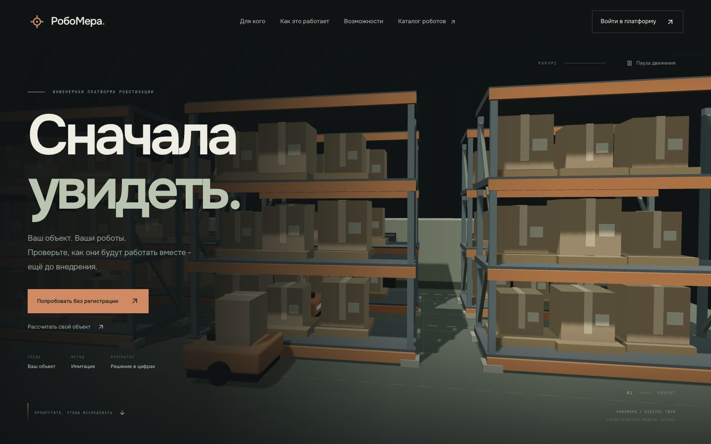
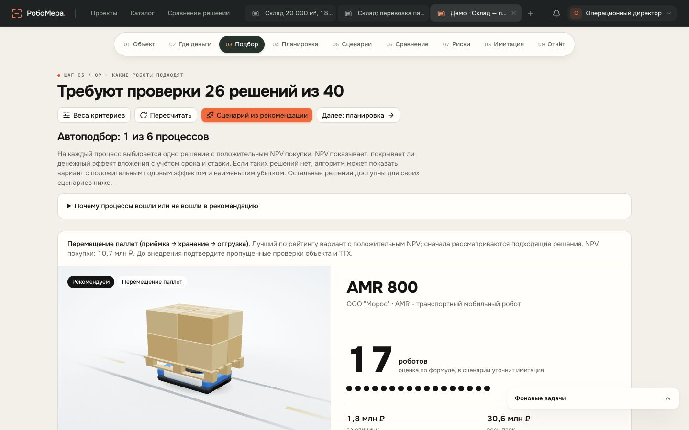
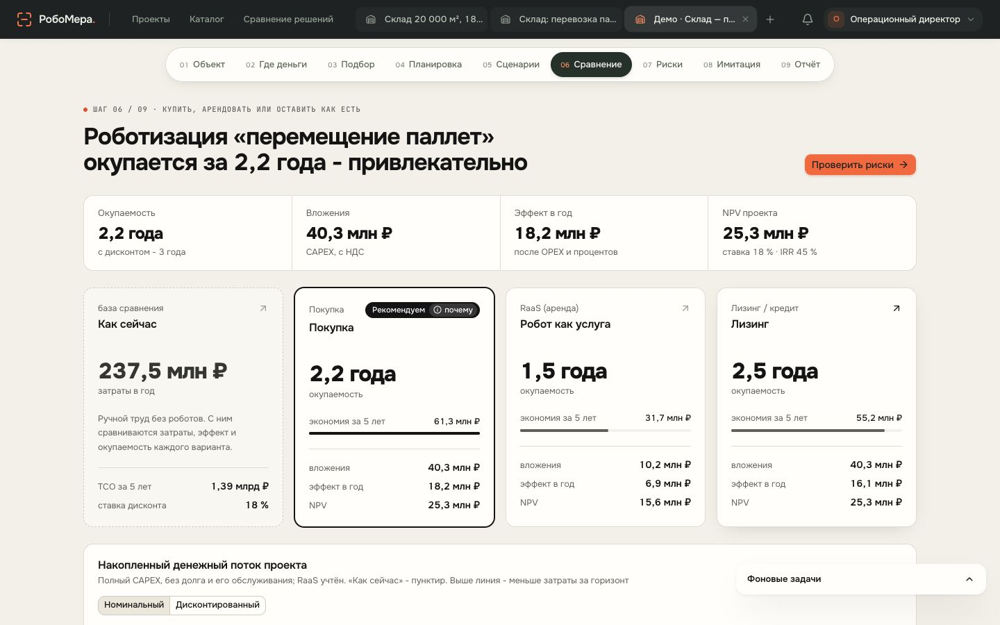
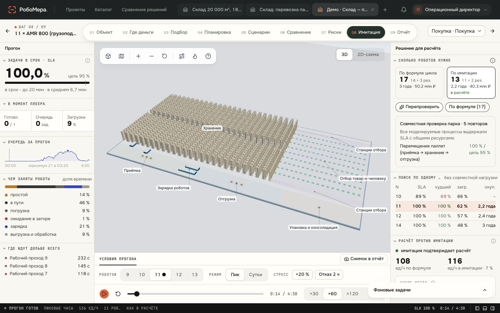
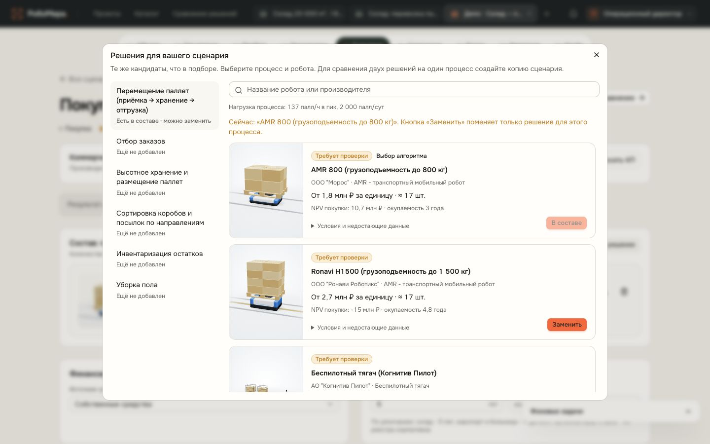

# РобоМера

Платформа для предварительной оценки роботизации склада, аэропорта или больницы. Помогает выбрать оборудование, проверить необходимое число роботов на планировке объекта и сравнить стоимость внедрения с текущими затратами.

Проект команды «Чупапис» для задачи № 1 ЛЦТ 2026 от ДПиИР Москвы и АНО «ФЦ БАС».

[Открыть сайт](https://prooood.ru/) · [Попробовать без регистрации](https://prooood.ru/demo) · [Демо-аккаунты](https://prooood.ru/login) · [Документация API](https://prooood.ru/api/docs)

## Демо и доступ

Начать можно с [готового склада](https://prooood.ru/demo/warehouse_demo_01). Сервис создаст вашу копию примера с параметрами, планировкой, четырьмя рассчитанными сценариями и результатами имитации. Можно менять данные, выбирать других роботов, пересчитывать экономику и скачивать отчёт.

| Пример | Что исследовать |
|---|---|
| [Склад](https://prooood.ru/demo/warehouse_demo_01) | Перевозка паллет, выбор парка и сравнение покупки, аренды и лизинга на данных организатора |
| [Фулфилмент 24/7](https://prooood.ru/demo/warehouse_showcase_24x7) | Несколько процессов на общей карте: паллеты, отбор заказов и уборка. Изменения исходного склада явно отмечены как допущения команды |
| [Больница](https://prooood.ru/demo/hospital_demo_01) | Доставка питания и общие лифты; проверка, оправдывает ли экономия стоимость внедрения |
| [Аэропорт](https://prooood.ru/demo/airport_demo_01) | Перевозка багажа тягачами и влияние маршрутов и неполных сцепок на число машин |

Примеры показывают и привлекательные, и неокупающиеся решения: результат зависит от объекта, состава оборудования и допущений. На странице демо также можно создать свой объект с пустыми параметрами или загрузить Excel, CSV либо JSON. Гостевые проекты доступны 24 часа; действие «Сохранить в аккаунт» переносит работу после входа или регистрации.

Для проверки ролей откройте [страницу входа](https://prooood.ru/login) и выберите кнопку в блоке «Демо-аккаунты». Эти же аккаунты создаются при локальном запуске.

| Роль | Почта | Возможности |
|---|---|---|
| Пользователь | user@robomera.demo | Личные и общие проекты, подбор, сценарии, имитация, отчёты |
| Администратор | admin@robomera.demo | Каталог, источники, версии нормативов, справочники, пользователи и модерация |
| Производитель | vendor@robomera.demo | Карточки своей компании, предложения правок, причины попадания в подбор, ответы на запросы КП |

Пароль для всех трёх аккаунтов: Demo12345!

В пользовательском аккаунте на стенде есть готовые проекты с префиксом «Демо» и черновики для самостоятельной работы. Аккаунт общий, поэтому для независимого эксперимента удобнее гостевая копия или копия проекта.

[Пример отчёта по складу, PDF](docs/assets/warehouse-report.pdf) — выгрузка из приложения с четырьмя сценариями, экономикой, имитацией, нормативами и источниками. Это сохранённый пример; свой отчёт можно сформировать на последнем шаге проекта.

## Что посмотреть

1. Откройте склад и изучите исходные параметры. У значений указано происхождение: ввод пользователя, данные примера, источник или допущение. Заполненность и подтверждённость данных показаны отдельно.
2. На шаге «Где деньги» посмотрите затраты на персонал и нагрузку по процессам. В «Подборе» откройте причины рекомендации, ограничения и недостающие характеристики кандидатов.
3. В «Сценариях» сравните рекомендованный состав со своим: добавьте или замените решение из визуального каталога. Можно менять количество, цену и условия финансирования; собственные значения сохраняются с обоснованием.
4. В «Сравнении» сопоставьте «Как сейчас», покупку, роботов как услугу и лизинг. Откройте сценарий, чтобы увидеть статьи затрат, денежный поток, формулы и источники.
5. В «Имитации» воспроизведите готовый прогон в 2D или 3D либо запустите новый. Проверка числа роботов учитывает очереди, маршруты, зарядки и общие ресурсы; принятый парк обновляет экономику. Прогресс фоновой задачи остаётся доступен при переходе на другой экран.
6. На шаге «Риски» измените объём работ, стоимость труда или оборудования и оцените чувствительность результата. В «Отчёте» выгрузите PDF, Excel с формулами или JSON.

Готовое демо сначала предлагает короткий путь из пяти шагов. «Все инструменты» открывает перечисленные разделы без потери изменений.

## Интерфейс

Снимки действующего стенда в формате 1440 × 900: объяснение подбора, сравнение вариантов, проверка парка и ручная сборка сценария. Изображение можно открыть отдельно для просмотра деталей.

| Подбор с причинами выбора | Покупка, RaaS и лизинг |
|---|---|
|  |  |

| Имитация на планировке | Свой состав оборудования |
|---|---|
|  |  |

## Локальный запуск

Нужны Git и запущенный Docker с Docker Compose. Python, Node.js, база данных и очередь устанавливаются внутри контейнеров. При первой сборке требуется интернет для загрузки образов и зависимостей; каталог и демо-данные уже находятся в репозитории. Ключи внешних сервисов для проверки основного функционала не нужны.

В терминале выполните по очереди:

1. git clone https://github.com/luhgeek1/robosim-studio-hack.git
2. cd robosim-studio-hack
3. docker compose up -d --build

После сборки и запуска доступны:

| Сервис | Адрес |
|---|---|
| Приложение | [localhost:3000](http://localhost:3000) |
| Swagger с операциями API | [localhost:8000/api/docs](http://localhost:8000/api/docs) |
| Готовность базы, очереди и воркера | [localhost:8000/api/v1/ready](http://localhost:8000/api/v1/ready) |

Миграции, каталог, нормативы и демо-аккаунты создаются автоматически. Готовые примеры подготавливаются в фоне: при первом открытии демо может показать ожидание расчёта. Создание своего проекта доступно отдельно.

Состояние контейнеров: docker compose ps -a. Сервис migrate должен завершиться с кодом 0; остальные сервисы продолжают работать. При ошибке запуска посмотрите журнал: docker compose logs --tail 100 migrate backend worker frontend.

Остановка: docker compose down. Проекты сохраняются в томе PostgreSQL и доступны после следующего запуска. Для остановки с полным удалением локальных данных: docker compose down -v.

Порты 3000, 8000, 5432 и 6379 должны быть свободны. При конфликте измените внешние порты в [docker-compose.yml](docker-compose.yml). Если Compose не понимает необязательный env-файл, обновите Docker Compose до актуальной версии. Параметры внешней почты и входа через сервисы перечислены в [примере окружения](backend/.env.example); для Docker Compose их задают в файле .env в корне проекта. Обычный демо-вход работает без этих настроек.

## Методика расчёта

1. Спрос рассчитывается по каждому процессу из объёма операций, рабочего времени и пикового коэффициента. Персонал распределяется между процессами без повторного учёта одной и той же группы.
2. Подбор проверяет физические и инфраструктурные ограничения, затем ранжирует кандидатов по объяснимым критериям. Неизвестная характеристика означает «требует проверки». Рекомендация учитывает экономику; остальные доступные кандидаты можно исследовать в собственных сценариях.
3. Стартовое число роботов рассчитывается из времени цикла, доступности, загрузки и резерва. Длины маршрутов берутся из замеров пользователя, планировки или явно указанного норматива.
4. Дискретно-событийная имитация ищет конфигурацию парка и проверяет моделируемые процессы вместе. Для принятия каждый процесс должен выдержать свой норматив выполнения задач во всех повторах. Результат записывается в сценарий и участвует в стоимости оборудования и экономике.
5. Сравнение учитывает вложения, эксплуатационные затраты, внедрение, разгон, индексацию и замены оборудования. NPV показывает эффект с учётом времени и ставки; ROI учитывает первоначальные вложения. Поток проекта отделён от потока собственных средств при финансировании.

Высвободившиеся часы работы и денежная экономия — разные показатели. Долю высвобождения, которая действительно снижает затраты, можно задать в сценарии. Изменение физических условий отменяет прежнее подтверждение парка; изменение цены сохраняет физическую проверку и требует обновить экономику.

Подробные формулы, источники, правила применения имитации и ограничения приведены в [методике](docs/METHOD.md). В интерфейсе любой расчёт можно раскрыть до исходных значений и их происхождения.

## Архитектура и данные

Браузер обращается к FastAPI через nginx. Сервер читает проекты и версии данных из PostgreSQL; долгие операции передаёт через Redis отдельному воркеру arq. Воркер сохраняет результаты в базе, поэтому завершение расчёта не требует открытой вкладки.

| Часть | Реализация |
|---|---|
| [Веб-клиент](frontend) | React 19, TypeScript, Vite, TanStack Query, Three.js и React Three Fiber. 2D- и 3D-плееры воспроизводят один журнал событий |
| [API и сервисы](backend/app) | Python 3.13, FastAPI, SQLAlchemy, Alembic; права доступа к личным и общим проектам |
| [Расчётное ядро](backend/app/engine) | Подбор, количество, экономика, чувствительность и SimPy. Ядро отделено от HTTP, базы данных и LLM |
| [Фоновые операции](backend/app/worker.py) | Имитация, поиск парка, отчёты и другие длительные задачи через arq и Redis 7 |
| Хранение | PostgreSQL 17: проекты, версии входов, расчёты, файлы и результаты имитации |
| [API-контракт](docs/api) | OpenAPI; типы фронтенда генерируются из контракта, ответы интеграционных тестов сверяются со схемами |
| [Данные организатора](case/dataset) | Каталог решений и параметры трёх типов объектов; загружаются при старте |
| [Нормативы и справочники](backend/app/seeds/data) | Формулы процессов, допущения, единицы и источники; изменения нормативов версионируются |
| [Дополнительные источники](research) | Характеристики роботов с происхождением и сценарии внедрения ФЦ БАС |

На публичном стенде frontend, API, воркер, PostgreSQL и Redis размещены на Fly.io. [Конфигурация стенда](deploy/fly) и [сценарий публикации](.github/workflows/deploy.yml) находятся в репозитории; для локального запуска достаточно Docker Compose.

Данные каталога можно обновлять через админку и импорт файла. Производитель предлагает изменения через модерацию. Есть организации с общими проектами и приглашениями, а также API для интеграций. Готовых подключений к WMS, ERP и 1С в этой версии нет: внешняя система может передавать параметры объекта через документированный API.

## Границы применения

- Это предварительная оценка для решения об обследовании и пилоте. Она не заменяет проект внедрения, коммерческое предложение и замеры на объекте.
- Глубже всего проработан склад. Для больницы моделируются доставки и лифты, для аэропорта — транспорт багажа и служебные перевозки. Уборка и другие неподдержанные имитацией процессы явно остаются на аналитическом расчёте.
- Планировка схематическая: учитывает маршруты и общие ресурсы, но не заменяет CAD и точную модель движения. Найденный парк прошёл проверку выбранных условий; глобальный минимум и реальный SLA не гарантируются.
- База «Как сейчас» описывает ручной труд без роботизации. Уже установленный парк отдельно не учитывается. Экономика рассчитывается до налога на прибыль, без моделирования вычета НДС.
- Недостающие характеристики и допущения остаются видимыми. Расчёт с неполными данными требует их проверки перед внедрением. LLM не используется для вычисления подбора, количества, экономики или имитации.

## Проверка реализации

Серверные тесты проверяют формулы, финансовые потоки, изоляцию проектов, API-контракт, совместную имитацию и формирование PDF/Excel/JSON на настоящих PostgreSQL и Redis.

Для полного серверного набора нужны Python 3.13, uv и Node.js 24; из корня репозитория выполните make check. Команда поднимает локальные PostgreSQL и Redis, запускает линтер, проверку типов, тесты и проверку OpenAPI. Тесты используют отдельные базы; не направляйте их на рабочую БД.

Проверка фронтенда: перейдите в frontend, выполните npm ci, затем npm run check. Проверяются типы, линтер, форматирование, маршруты, восстановление после обновления и сборка приложения. Браузерные сценарии находятся в [frontend/e2e](frontend/e2e) и запускаются отдельно командой npm run test:e2e после npx playwright install chromium; для них нужен тестовый API на localhost:8000.

На действующем стенде проверены пиковые прогоны пяти готовых демо и полный поиск парка для склада, фулфилмента, больницы и аэропорта с сохранением результата и пересчётом экономики. Один прогон и поиск парка — разные операции: полный поиск включает десятки повторов и может занимать больше минуты; интерфейс показывает ход выполнения.

## Что доработано после обратной связи

| Замечание экспертов | Что изменилось |
|---|---|
| Нужны объясняющий лендинг и демо без авторизации | Новый лендинг, четыре готовых примера и гостевые копии с реальными расчётами, изменением параметров и экспортом |
| Покупка, услуга и выбранные роботы должны быть видны сразу | Обновлены сравнение и карточки сценариев; состав парка доступен рядом с экономическими показателями |
| Следует перепроверить NPV и ROI | Разделены потоки проекта и собственника, уточнён учёт первоначальных вложений и ручного труда; добавлены проверки финансовых инвариантов |
| Важно объяснить выбор и изменение числа роботов | Подбор показывает причины включения и исключения, недостающие данные и экономику; формула сопоставляется с совместной проверкой парка |
| Допущения должны быть понятны и проверяемы | Источники и версии доступны в расчёте и отчёте; денежная реализация высвобождаемого труда выделена отдельно |
| Интерфейс должен подходить и руководителю, и инженеру | Короткий путь знакомства и полный набор инструментов, визуальное добавление решений, редактируемый импорт, подсказки у ошибок и постоянная панель фоновых задач |

Доработки сопровождаются регрессионными тестами и проверками демо. Следующий этап — обследование реальных объектов, уточнение производительности и условий поставщиков, затем сопоставление результатов модели с пилотным внедрением.
