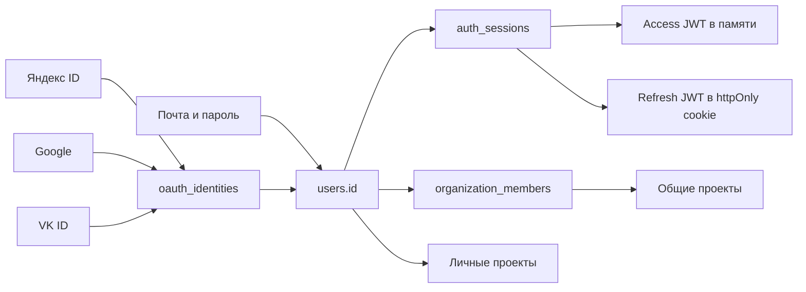

# Аутентификация, аккаунты и организации

Реализация от 20.10.2026. Сервер — FastAPI/PostgreSQL, временное состояние OAuth и лимиты — Redis.
Письма — Resend; браузер использует прежний серверный API и cookies, без внешнего auth-хостинга.

## Границы сущностей

**Пользователь — один человек в РобоМере.** У него один внутренний `users.id`, личные проекты и несколько способов
входа. Google, Яндекс ID и VK ID не создают отдельных рабочих областей при явном подключении к существующему аккаунту.

**Организация — общая рабочая область после аутентификации.** Пароля или общего токена организации нет.
Человек входит любым подключённым способом; сервер проверяет актуальное членство и роль при обращении к проекту.
Индивидуальный вход через корпоративный IdP/SAML и автоматическое вступление по домену почты не реализованы.



## Таблицы

| Таблица | Данные и ограничения |
|---|---|
| `users` | UUID, уникальный email (`CITEXT`, без учёта регистра), имя, глобальная роль, `is_active`, `auth_version`, `email_verified_at`, даты; отдельный срок гостя. Поле `organization` — старое текстовое описание компании, не членство и не источник прав. |
| `user_credentials` | PK/FK `user_id`, Argon2id-хеш пароля, даты. У аккаунта только через IdP строки нет; фиктивный пароль не генерируется. |
| `oauth_identities` | UUID, FK `user_id`, `provider`, стабильный `subject`, дата подключения. Уникальны `(provider, subject)` и `(user_id, provider)`: один аккаунт каждого сервиса на пользователя. Email провайдера не является ключом связи. Токены провайдера не сохраняются. |
| `auth_sessions` | UUID, FK `user_id`, digest текущего refresh `jti`, клиент (`web`/`mobile`), метод входа, даты создания/продления, абсолютный срок, `revoked_at`. Access и refresh содержат `sid`, UUID пользователя и версию доступа. |
| `auth_email_tokens` | UUID, FK `user_id`, email и `auth_version` на момент выдачи, назначение (`verify_email`/`reset_password`), SHA-256 случайного секрета, срок и `consumed_at`. Секреты разных назначений невзаимозаменяемы. |
| `organizations` | UUID, название, создатель. Не является аккаунтом и не содержит credentials. |
| `organization_members` | Составной PK `(organization_id, user_id)`, роль `owner`/`member`, дата вступления. |
| `organization_invitations` | UUID, организация, email адресата, пригласивший, статус, срок, digest секрета и дата ответа. Уникальное ожидающее приглашение на `(organization_id, email)`. |
| `email_outbox` | Снимок письма, ровно одна ссылка на приглашение или email-token, статус, попытки, следующая попытка, время принятия Resend, ID письма и безопасный код ошибки. Секрет в теле нужен для доставки; после отправки или окончательной ошибки тело очищается. |
| `api_keys` | Отдельные ключи интеграций с хешем секрета и scopes. В браузерный вход и членство организации не превращаются; управляются отдельно. |

Все привязки к пользователю имеют FK; удаление гостя удаляет его сессии. Секреты email-ссылок — 32 случайных байта,
в таблицах проверяется digest. Само письмо до отправки содержит рабочую ссылку, поэтому доступ к БД и резервным
копиям должен быть ограничен так же, как доступ к другим секретам приложения.

## Регистрация и вход по паролю

1. `POST /auth/register`: нормализация email, проверка уникальности, создание `users`, `user_credentials`
   и сессии в одной транзакции. Конкурентная регистрация на тот же адрес отвечает 409.
2. Если почта настроена, в этой же транзакции создаются одноразовый verification-token и письмо в outbox.
   Аккаунт сразу работает с личными проектами; для создания организации, приглашения коллег и подключения IdP
   требуется подтверждённая почта. Переход из приглашения может подтвердить адрес при принятии по секрету письма.
3. В письме ссылка `/verify-email#token=…`. GET открывает экран; только нажатие кнопки вызывает
   `POST /auth/email/verify`. Срок по умолчанию 24 часа. Подтверждение не создаёт сессию и не входит автоматически.
4. `POST /auth/login` проверяет Argon2id в thread pool, активность пользователя, при необходимости обновляет хеш.
   Неверный пароль, неизвестный адрес и аккаунт без пароля дают одинаковый 401. На пути неизвестного адреса также
   выполняется дорогая операция хеширования. Пароли: 8–128 символов, без принудительных правил состава.
5. Access JWT возвращается в JSON и хранится в памяти приложения. Для web refresh только в httpOnly-cookie;
   CSRF-cookie доступна JS. Для mobile refresh возвращается в JSON, его безопасное хранение — обязанность клиента.

## Вход через Яндекс ID, Google и VK ID

```mermaid
sequenceDiagram
    participant B as Браузер
    participant A as API РобоМеры
    participant R as Redis
    participant I as Провайдер
    B->>A: POST /auth/oauth/{provider}/start
    A->>R: state, PKCE verifier, digest cookie, цель, TTL 10 мин
    A-->>B: authorization_url + httpOnly cookie
    B->>I: Авторизация и согласие на базовый профиль
    I-->>A: callback: code, state; VK также device_id
    A->>R: Проверка браузера + одноразовый GETDEL
    A->>I: Обмен code с PKCE verifier
    A->>I: Чтение профиля с выданным access token
    A->>A: Поиск provider + subject, создание сессии
    A-->>B: Refresh/CSRF cookies + 303 на исходную страницу
```

- Используется Authorization Code + PKCE S256; для VK ID — современный OAuth 2.1, `device_id` и проверка `state`
  ответа обмена. Яндекс и Google также используют client secret на сервере. VK ID в этом потоке использует App ID и PKCE.
- `state` одноразовый, связан с отдельной случайной browser-cookie, хранится 10 минут в Redis. Cookie — httpOnly,
  SameSite=Lax; в production Secure. Несколько попыток используют разные cookie. Чужой браузер не расходует state.
- Callback возвращается на настроенный origin; `return_to` принимает только внутренний относительный путь.
  В Location нет access/refresh-токенов. Токен провайдера применяется только для чтения профиля по HTTPS и не хранится.
- Существующая identity ведёт к прежнему `users.id`, даже если email в профиле провайдера изменился.
- Новая identity с новым email создаёт пользователя без пароля. Google требует `email_verified=true` и подтверждает
  этот адрес. Для Яндекса/VK не предполагаем наличие эквивалентного признака: доступ к командным действиям — после
  письма или подтверждения приглашения. Без email самостоятельная регистрация через сервис отклоняется с пояснением;
  аккаунт можно создать по почте и затем подключить сервис.
- Если такой email уже есть, автоматического merge нет: нужно войти прежним способом и подключить сервис в аккаунте.
  Это защищает credentials-аккаунты и аккаунты другого IdP от захвата по совпадающему адресу.
- При сбое после создания пользователя транзакция откатывается; не остаётся половины аккаунта.

## Подключение и отключение способов входа

На `/account` человек видит пароль, провайдеров и активные сессии.

1. Для подключения: подтверждённый canonical email, действующие access и refresh одной учётки и вход за последние
   10 минут. Обычное refresh-продление не обновляет время повторного подтверждения личности.
2. `intent=link` сохраняет ID пользователя и его `auth_version` в серверном state. На callback повторно проверяются
   текущая cookie, версия, активность сессии и давность входа. Смена аккаунта или отзыв сессии прерывает привязку.
3. Сервис с другим email можно подключить явно. Основной email аккаунта при этом не меняется. Identity другого
   пользователя подключить нельзя; гонки ограничены блокировками и уникальными индексами.
4. Для отключения нужен недавний вход. Последний метод без пароля отключить нельзя. Отключение отзывает все сессии;
   после него нужно войти оставшимся способом.
5. Для изменения существующего пароля нужен текущий пароль. Для добавления первого пароля — подтверждённая почта
   и недавний вход. Сохранение закрывает все сессии.

## Сессии и восстановление

- Access по умолчанию 15 минут, сессия/refresh — 7 дней от входа; refresh не сдвигает абсолютную границу.
  Гостевая сессия дополнительно ограничена 24 часами и удалением гостевого пространства.
- Refresh блокирует строку сессии и атомарно меняет digest `jti`. Повтор старого JWT отзывает всю эту сессию,
  включая уже выданный access и новый refresh. Независимые сессии пользователя сохраняются.
- Решение об отзыве при reuse коммитит зависимость UoW перед ответом 401. Оно не исчезает при перезапуске Redis.
- Каждый защищённый запрос проверяет пользователя, `auth_version` и живую строку сессии. Поэтому logout и ручной
  отзыв действуют немедленно. Cookie-refresh и cookie-logout требуют CSRF. На ошибке refresh cookies очищаются.
- Во фронте refresh объединён внутри вкладки; Web Locks сериализует вход, регистрацию, refresh и logout между вкладками одного origin.
  BroadcastChannel сообщает другим вкладкам об изменении сессии без передачи токенов: профиль и кэш перечитываются;
  запоздавший ответ предыдущего восстановления не заменяет новый вход.
  Клиенты без Web Locks и самостоятельные API-клиенты должны сами сериализовать refresh: параллельный повтор может
  вызвать защитный отзыв сессии.
- `/auth/password/forgot` отвечает одинаково для известного и неизвестного адреса. Письмо создаётся только для
  активного аккаунта с credentials. Аккаунт только через IdP восстанавливает доступ в своём сервисе.
- Ссылка сброса живёт 30 минут; новый выпуск отменяет предыдущий. При использовании проверяются назначение, email,
  версия пользователя, срок и одноразовость. Смена/сброс пароля отзывает все сессии и прежние email-токены.
  После сброса требуется обычный вход; автоматического логина по reset-ссылке нет.
- Лимиты IP применяются к входу, регистрации, OAuth и email-действиям. Выпуск писем дополнительно ограничен одним
  за минуту на пользователя и назначение; повторный запрос получает тот же нейтральный ответ.

История сессий удаляется через 30 дней после абсолютного истечения, email-токены — через сутки после истечения.

## Приглашение в организацию

1. Владелец с подтверждённой почтой вводит email. API проверяет полномочия, существующее членство и дубликат.
2. В одной транзакции создаются приглашение с digest/сроком и outbox-письмо. API отвечает `email_delivery=queued`.
3. Письмо от `РобоМера <invite@mail.prooood.ru>` содержит ссылку `/invitations/{id}#token=…`, по умолчанию на 7 суток.
   Секрет находится во фрагменте, а не в HTTP query. Интерфейс убирает фрагмент и хранит секрет в sessionStorage
   этой вкладки до принятия/закрытия, чтобы сохранить его при переходе ко входу.
4. `POST /auth/invitations/{id}/preview` показывает команду и адрес только по правильному секрету. Сам просмотр
   никого не добавляет, GET никогда не принимает приглашения.
5. Без аккаунта предлагается вход/регистрация с возвратом к этой странице. При другой почте — смена аккаунта.
6. Нажатие «Принять» вызывает POST с секретом и access JWT. Сервер под блокировкой сверяет email аккаунта, digest,
   статус и срок. Затем создаёт membership, помечает приглашение принятым и подтверждает адрес пользователя.
7. Повтор, отозванное/истёкшее приглашение и другой адрес отклоняются. Истёкшее приглашение можно создать заново.
   Уведомление в приложении направляет к письму, если нужен секрет. Для чтения/отклонения входящих нужна подтверждённая почта.
8. Роли в команде не меняют глобальную роль пользователя. Удаление участника закрывает общие проекты немедленно:
   права читаются из memberships, а не из старого JWT. Личные проекты остаются личными.

## Доставка и локальный режим

- Отправка запускается после транзакции: API-loop при `RS_JOBS_BACKEND=inline` или cron arq при `arq`.
  PostgreSQL/outbox остаётся источником истины, несколько отправителей используют `FOR UPDATE SKIP LOCKED`.
- `sent` означает принятие письма Resend, не подтверждение попадания в ящик. Webhook доставок/bounce пока не подключён.
- У письма неизменяемый снимок и ключ идемпотентности. Таймаут HTTP — 10 с, до 5 попыток с экспоненциальной задержкой;
  429/5xx и транспортные сбои повторяются. Постоянные ошибки не повторяются. После 23 часов запрос не повторяем:
  окно дедупликации Resend — 24 часа. Ошибки логируются кодом, без адресов, тела и токенов.
- Перед отправкой проверяются актуальность приглашения/токена. Отзыв/потребление отменяет ещё не отправленное письмо.
  При окончательном сбое приглашение можно отозвать и создать заново.
- Без ключей IdP соответствующая кнопка входа скрыта. Credentials и публичное демо остаются доступны.
- В dev/test без почты сохраняется прежний режим приглашений через уведомления. В production создание почтового
  приглашения без настроенной отправки отвечает 503; командные действия требуют подтверждённого email.
- Демо-учётки организатора преднамеренно общие и заранее подтверждены. Они предназначены для конкурсного стенда;
  полноценный закрытый коммерческий запуск требует отдельного стенда без публичного административного демо-доступа.

## Шаблоны писем и действующая конфигурация

С 21.10.2026 приглашения, подтверждение email и сброс пароля используют общий HTML-шаблон в
`backend/app/service/mail/transactional.html`: цвета РобоМеры, кнопка, резервная ссылка, срок и ссылка на политику.
Текстовая версия остаётся; все пользовательские значения экранируются. Внешних изображений и шрифтов в письмах нет.

Resend-домен `mail.prooood.ru` проверен через API: verified, sending enabled, регион Ireland/eu-west-1.
Отправитель — `РобоМера <invite@mail.prooood.ru>`. Click/open tracking выключен; DNS менять не потребовалось.
`RS_RESEND_API_KEY` и `RS_EMAIL_FROM` хранятся в Fly Secrets приложения `robomera-api` (API и worker).
Локальная копия — `.secrets/resend/.env`, права `0600`, Git/Docker исключают файл; реальные значения в документацию не копировать.

После настройки владелец с подтверждённой почтой заново создаёт приглашение через интерфейс организации.
Если старое ожидающее приглашение мешает повтору, его нужно отозвать и пригласить ещё раз.
Уже созданные приглашения автоматически массово не рассылаются.

Проверка production 21.10.2026: через API создана отдельная пустая команда «Тест доставки — РобоМера» и одно
приглашение на согласованный владельцем адрес. Outbox перешёл `queued → sent`; Resend вернул `delivered`.
Проверен HTML нового шаблона и preview секретной ссылки (200); вступление не выполнялось.
Это подтверждает приём почтовым сервером адресата, но не размещение во «Входящих» вместо «Спама».

## Подключение провайдеров и Resend

Пошаговое создание приложений в кабинетах Google, Яндекса и VK — [OAUTH_SETUP.md](OAUTH_SETUP.md).
Для VK учтены ограничения localhost и выбор публичного PKCE-клиента.

Пример переменных — `backend/.env.example`. Ключи добавляются в серверное окружение/Fly Secrets, не в Git и не в `VITE_*`.

```
RS_PUBLIC_WEB_URL=https://prooood.ru
RS_PUBLIC_API_URL=https://prooood.ru
RS_COOKIE_SECURE=true
RS_COOKIE_SAMESITE=lax
RS_EMAIL_FROM=РобоМера <invite@mail.prooood.ru>
RS_RESEND_API_KEY=<секрет Resend с Sending access на mail.prooood.ru>
RS_YANDEX_CLIENT_ID=<ID приложения>
RS_YANDEX_CLIENT_SECRET=<секрет>
RS_GOOGLE_CLIENT_ID=<ID Web application>
RS_GOOGLE_CLIENT_SECRET=<секрет>
RS_VK_CLIENT_ID=<ID приложения VK ID>
```

Web и API должны иметь один публичный origin; `/api` проходит через proxy. Локально оба URL —
`http://localhost:5173`, Vite проксирует API на 8000. Не смешивайте localhost и 127.0.0.1 в одном потоке.

| Сервис | Redirect URI | Минимальные права |
|---|---|---|
| Яндекс ID | `https://prooood.ru/api/v1/auth/oauth/yandex/callback` | `login:info login:email` |
| Google | `https://prooood.ru/api/v1/auth/oauth/google/callback` | `openid email profile` |
| VK ID | `https://prooood.ru/api/v1/auth/oauth/vk/callback` | `email` и базовый профиль; OAuth 2.1/PKCE |

1. В кабинетах IdP создать веб-приложения, указать эти адреса без лишнего `/`, настроить название/домен/экран согласия.
   Для Google учесть исключение Testing для базовых прав и завершить Branding/Audience по OAUTH_SETUP.md.
2. `mail.prooood.ru` уже подтверждён по предоставленному скриншоту Resend. Используется отправитель этого поддомена;
   менять A/AAAA основного сайта или DNS целиком не нужно. При смене поддомена сверять точные DKIM/SPF/MX с Resend.
3. Для auth-поддомена отключить click/open tracking в Resend: секретные ссылки не должны переписываться трекером.
   Предупреждение о недоступном custom tracking domain не блокирует обычную отправку.
4. После добавления секретов запустить миграции и перезапустить API/воркер. Проверить `/auth/oauth/providers`,
   реальный вход каждым IdP, письмо на контролируемый адрес и принятие новым/существующим пользователем.
5. Реальный внешний вход и доставку нельзя считать подтверждёнными по mocked-тестам: нужна эта проверка с ключами.

Миграция переносит существующие хеши паролей без изменения; проверена в обе стороны. Старые JWT без `sid`
требуют повторного входа. Старые приглашения без секрета в production принимает только аккаунт с подтверждённой почтой;
новые production-приглашения всегда почтовые. Ключи Google, Яндекса и Resend подключены через Fly Secrets.

Источники протоколов и ограничений (проверены 20.10.2026):
[Яндекс: код и PKCE](https://yandex.ru/dev/id/doc/ru/codes/code-url),
[Яндекс: профиль](https://yandex.ru/dev/id/doc/ru/user-information),
[Google: OpenID Connect](https://developers.google.com/identity/openid-connect/openid-connect),
[VK ID: официальный SDK](https://github.com/VKCOM/vkid-web-sdk/blob/master/src/auth/auth.ts),
[Resend: идемпотентность](https://resend.com/docs/dashboard/emails/idempotency-keys),
[Resend: tracking](https://github.com/resend/resend-skills/blob/main/skills/resend/references/sending/overview.md).
